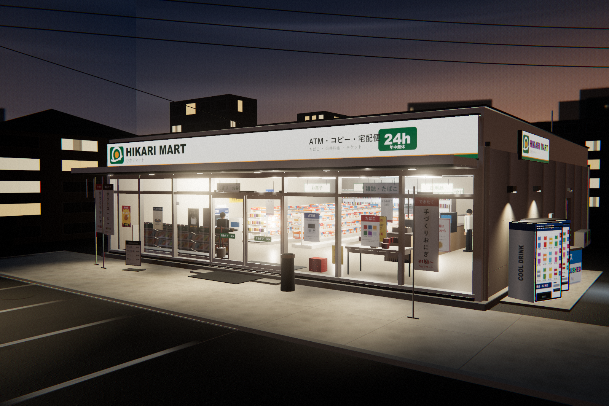

# ひかりマート 三丁目店 — 日式便利店三维建模

一个用 three.js 程序化建模的日式便利店（コンビニ）夜景。全部几何、材质与贴图在运行时生成，
无外部模型或图片资源；品牌为虚构的「ひかりマート / HIKARI MART」，避免真实商标。



**在线看（手机也能开）：<https://ljjjc123.github.io/japanese-konbini/>**

## 运行

双击 `serve.cmd`（会用本地 HTTP 服务打开 `index.html`，默认端口 8024）。
页面里的按钮可切换 6 个机位、自动旋转、开关 Bloom，点击任意构件可查看其名称。

> `index.html` 通过 importmap 引用随项目附带的 `./vendor/three`（three r169 的 build 与所需 addons），
> 无需 npm install；但必须用 HTTP 方式打开，直接双击 HTML 会被浏览器的模块 CORS 策略拦住。
> 想直接发文件给别人，用 `konbini-share.html`（单文件、可双击离线打开）；想自己部署，
> 用 `konbini-site.zip`（拖到 Netlify Drop / 任意静态托管即可）。

重新构建：`node node_modules/typescript/bin/tsc -p tsconfig.json`
截图：`node tools/shot.mjs renders/out.png hero 1600 1067`（需先在项目目录起 8023 端口的静态服务）

## 场景构成

**用地 20 × 24 m，建筑 13.6 × 15.8 m，檐口高 3.55 m，女儿墙 4.42 m。**

- **外装**：混凝土基座 / 米色压型钢板外墙 / 白铝框通高玻璃幕墙 / 中横档 /
  自动感应双开玻璃门（含「自動ドア」贴纸）/ 白色灯箱招牌（正面 13.7 m 通长，侧面山墙招牌）/
  雨棚（6 处筒灯）/ 女儿墙压顶 / 屋面检修口、天窗、天线、空调外机、通气管。
- **内装**：两列双面货架（约 900 件实例化商品，4 种包装设计轮换）、杂志架（60 本封面）、
  6 门冷藏饮料柜（约 340 支瓶罐实例）、冷冻岛柜、收银台（POS、加热柜、关东煮锅、咖啡机、
  香烟背柜、后场货架）、ATM、复印机、宅配便柜台、购物篮、伞架、吊旗、通道吊牌、宣传桌。
- **场地**：混凝土前场 + 沥青停车场（磨损白线、挡车器、边石）、自动售货机 2 台、冰柜、
  分类垃圾桶、广告旗（のぼり）、A 字招牌、烟灰缸、自行车架与自行车、电线杆（变压器、横担、
  绝缘子、路灯、架空线）、停车牌、绿篱、邻栋公寓与住宅、远景城市剪影。
- **人物**：收银员与正在看杂志的顾客（低多边形剪影，提供尺度与生活感）。

## 材质与光照

- 沥青 / 混凝土 / 压型钢板 / 塑胶地板 / 矿棉板吊顶 / 屋面卷材均为 canvas 程序化贴图，
  沥青附带由高度图 Sobel 生成的法线贴图与粗糙度贴图（干湿分区），混凝土有收光纹理与分格缝。
- 招牌、海报、售货机扉、煙草背柜、杂志封面、价格牌等全部为 canvas 绘制的日文图形。
- 夜景：半球光 + 冷色月光平行光（阴影）+ 雨棚 4 盏射灯 + 店内 7 盏点光 + 低位反射补光 +
  街灯 / 壁灯射灯，并配合加色光斑贴片伪造光池；环境光为自建的「蓝调时刻」PMREM 环境。
- 后处理：HDR + UnrealBloom + ACES 色调映射 + 自写的暗角 / 胶片颗粒 / 轻微色差 Pass，
  各机位单独设定曝光（外景 1.05，室内 0.25），模拟真实相机的曝光策略。

## 目录

```
index.html        交互页面（HUD、机位、拾取）
src/              TypeScript 源码
  tex.ts          程序化贴图（沥青/混凝土/钢板/地板/吊顶/天空/图形面板）
  graphics.ts     品牌、招牌、海报、售货机、杂志封面等 canvas 图形
  mats.ts         材质库
  building.ts     建筑外壳、幕墙、自动门、招牌、雨棚、屋面
  interior.ts     货架、商品、冷柜、收银台、ATM、人物、店内灯光
  site.ts         场地、停车场、售货机、电线杆、邻栋、道具、场地灯光
  main.ts         渲染器、天空环境、后处理、机位、交互
dist/             编译结果（页面直接引用）
vendor/three/     随附的 three.js 运行时
renders/          渲染图
tools/            截图与拼图脚本
```
